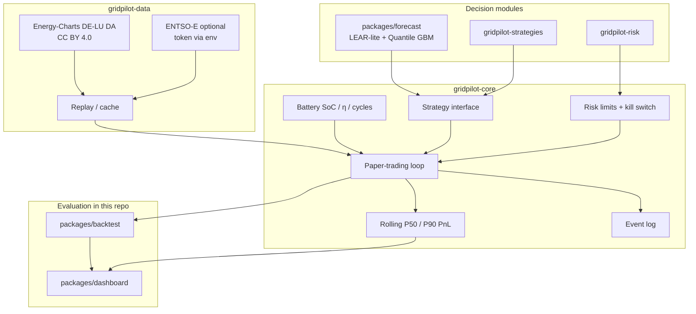

# GridPilot

**Open paper-trading agent stack for electricity markets** — live/near-live public data, pluggable charge/discharge strategies, risk limits, probabilistic P10/P50/P90 outcome tracking, ML forecasting, walk-forward backtests, and a Streamlit dashboard.

GridPilot is one public GitHub project ([this repo](https://github.com/DataWithSyed/gridpilot)) with **module packages** under `packages/` plus linked sibling repos for core/data/risk/strategies.

> **Paper trading only.** Nothing in GridPilot places real orders on any power exchange or broker. There is no live execution path in the public code.

## Why this exists

Battery storage and flexible demand need an **agent loop**: observe the market → forecast → decide under risk limits → simulate fills → learn. Prior single-repo studies under [@DataWithSyed](https://github.com/DataWithSyed) already cover forecasting, reserve stacking, LCOS, and lab data. GridPilot **links** those ideas into a coherent agent architecture instead of duplicating them.

## Architecture



## Roadmap

- [x] **Umbrella** (`gridpilot`): architecture, methods, assumptions, contributing *(this repo)*
- [x] **Core runtime** ([`gridpilot-core`](https://github.com/DataWithSyed/gridpilot-core)): battery · strategies · paper loop · Energy-Charts replay · risk limits · P50/P90
- [x] **Data adapters** ([`gridpilot-data`](https://github.com/DataWithSyed/gridpilot-data)): Energy-Charts live/near-live + replay + optional ENTSO-E env-token adapter
- [x] **Forecasting** (`packages/forecast`): LEAR-lite + quantile GBM ensemble (P10/P50/P90); links `de-day-ahead-price-forecasting` (price-only features here)
- [x] **Risk engine** ([`gridpilot-risk`](https://github.com/DataWithSyed/gridpilot-risk)): block-bootstrap scenario PnL, VaR / CVaR, limit hooks
- [x] **Strategy pack** ([`gridpilot-strategies`](https://github.com/DataWithSyed/gridpilot-strategies)): forecast-driven + risk-aware LP (climatology baseline)
- [x] **Backtest harness** (`packages/backtest`): walk-forward comparison table, CLI, equity figure
- [x] **Dashboard** (`packages/dashboard`): Streamlit ops view (testable package + thin `app.py`)

## Repo layout

```
gridpilot/
  packages/forecast/     # probabilistic DA price forecasts + ML strategies
  packages/backtest/     # comparison harness + CLI
  packages/dashboard/    # Streamlit UI
  docs/                  # methods, assumptions, limitations
```

Sibling module repos (unchanged, linked): `gridpilot-core`, `gridpilot-data`, `gridpilot-risk`, `gridpilot-strategies`.

## Measured results so far (real runs)

Window **2026-08-01 → 2026-10-15**, DE-LU day-ahead via Energy-Charts (CC BY 4.0), 15-min → hourly means, illustrative **1 MW / 2 MWh** BESS. Paper trading only; no fees/slippage.

| Module | Highlight |
|---|---|
| [`gridpilot-core`](https://github.com/DataWithSyed/gridpilot-core) | Threshold cash **9,993** € (39.6% of PF oracle **25,228** €); daily PnL P50 **144.73** € |
| [`gridpilot-data`](https://github.com/DataWithSyed/gridpilot-data) | **1,824** hourly bars; DA mean **140.48** €/MWh; **5.15%** negative hours |
| [`gridpilot-risk`](https://github.com/DataWithSyed/gridpilot-risk) | Daily VaR₅% / CVaR₅% (threshold) **70.36 / 150.37** €; 21-day bootstrap cash P50 **2,499** € (40 paths) |
| [`gridpilot-strategies`](https://github.com/DataWithSyed/gridpilot-strategies) | **ForecastDrivenLP** (climatology) cash **14,145** € (**+41.6%** vs threshold; **56.1%** of PF); RiskAware daily CVaR₅% **3.92** € |
| `packages/forecast` | Walk-forward MAE: ensemble **38.07** vs naive **48.40** €/MWh (55–62 days). **MLForecastDrivenLP** cash **14,358** € (**56.9%** of PF; **+1.5%** vs climatology ForecastDrivenLP **14,145** €). ML risk-aware **14,387** € |
| `packages/backtest` | Comparison CSV + figures under `packages/backtest/results` and `figures/` (same window) |
| `packages/dashboard` | Headless health ok; Streamlit AppTest ok |

### Strategy comparison (real run, same window)

| Strategy | Final cash € | Capture of PF | Daily PnL P10 / P50 / P90 € | CVaR₅% loss € |
|---|---:|---:|---|---:|
| Threshold | 9,993 | 39.6% | 0.00 / 144.73 / 301.47 | 150.37 |
| ForecastDrivenLP (climatology) | 14,145 | 56.1% | 20.86 / 183.10 / 354.14 | 16.74 |
| RiskAwareForecastLP (climatology) | 10,107 | 40.1% | 0.00 / 113.83 / 310.17 | 3.92 |
| **MLForecastDrivenLP** | **14,358** | **56.9%** | 14.41 / 198.68 / 377.33 | 20.90 |
| **MLRiskAwareForecastLP** | **14,387** | **57.0%** | 12.23 / 169.57 / 382.80 | 11.69 |
| Perfect foresight (oracle) | 25,228 | 100% | 163.07 / 304.59 / 484.19 | n/a (no loss) |

Honest takeaway: on this **short ~2.5-month** sample, price-only ML **slightly beats** the hour-of-day climatology on cash (+~213 €) and clearly beats naive MAE. It does **not** close most of the gap to perfect foresight. Full LEAR+TSO features live in the linked `de-day-ahead-price-forecasting` repo. ML refit every **3** days (ASSUMED compute tradeoff).

## Quick start

```bash
# sibling checkouts beside this repo recommended
git clone https://github.com/DataWithSyed/gridpilot.git
git clone https://github.com/DataWithSyed/gridpilot-core.git
git clone https://github.com/DataWithSyed/gridpilot-strategies.git

cd gridpilot
python -m venv .venv && source .venv/bin/activate
pip install -e packages/forecast -e packages/backtest -e "packages/dashboard[ui]"
pip install -e ../gridpilot-core -e ../gridpilot-strategies

pytest -q packages/forecast packages/backtest packages/dashboard
python packages/forecast/scripts/run_forecast_eval.py
python -m gridpilot_backtest.cli
python packages/dashboard/scripts/healthcheck.py
streamlit run packages/dashboard/app.py
```

## Related work

See [`docs/related-work.md`](docs/related-work.md). Highlights:

- [de-day-ahead-price-forecasting](https://github.com/DataWithSyed/de-day-ahead-price-forecasting)
- [de-bess-reserve-revenue-stacking](https://github.com/DataWithSyed/de-bess-reserve-revenue-stacking)
- [epm-data-pipeline](https://github.com/DataWithSyed/epm-data-pipeline) · [eu-power-market-lab](https://github.com/DataWithSyed/eu-power-market-lab)
- [bess-lcos-montecarlo-irr](https://github.com/DataWithSyed/bess-lcos-montecarlo-irr)

## Docs

- [`docs/methods.md`](docs/methods.md) — literature anchors (DOIs)
- [`docs/assumptions.md`](docs/assumptions.md) — labelled ASSUMED defaults
- [`docs/limitations.md`](docs/limitations.md) — honest scope limits
- [`CONTRIBUTING.md`](CONTRIBUTING.md) — how to help
- [`docs/issue-templates/`](docs/issue-templates/) — bug / feature templates

## Licence

MIT for code and documentation in this umbrella. Upstream market data keep their own licences — always attribute (Energy-Charts / SMARD, and others as added).
