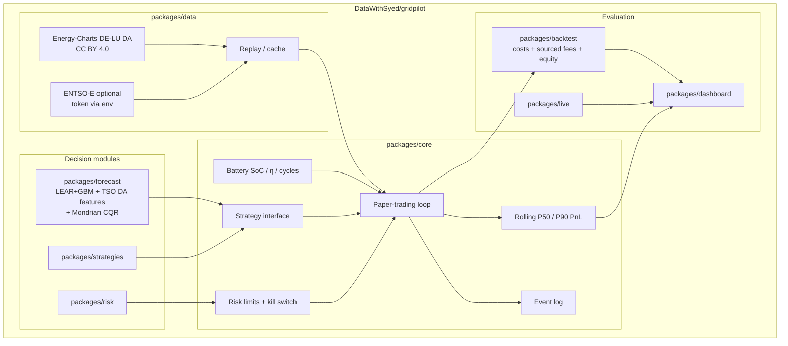

# GridPilot

**Open paper-trading agent stack for electricity markets** — live/near-live public data, pluggable charge/discharge strategies, risk limits, probabilistic P10/P50/P90 outcome tracking, ML forecasting, walk-forward backtests, and a Streamlit dashboard.

GridPilot is **one public GitHub project** ([this repo](https://github.com/DataWithSyed/gridpilot)). The former sibling repos (`gridpilot-core`, `gridpilot-data`, `gridpilot-risk`, `gridpilot-strategies`) now live under `packages/` in this repository.

> **Paper trading only.** Nothing in GridPilot places real orders on any power exchange or broker. There is no live execution path in the public code.

## Why this exists

Battery storage and flexible demand need an **agent loop**: observe the market → forecast → decide under risk limits → simulate fills → learn. Prior single-repo studies under [@DataWithSyed](https://github.com/DataWithSyed) already cover forecasting, reserve stacking, LCOS, and lab data. GridPilot **links** those ideas into a coherent agent architecture instead of duplicating them.

## Architecture



## Roadmap

- [x] **Umbrella** (`gridpilot`): architecture, methods, assumptions, contributing *(this repo)*
- [x] **Core runtime** (`packages/core`): battery · strategies · paper loop · Energy-Charts replay · risk limits · P50/P90
- [x] **Data adapters** (`packages/data`): Energy-Charts live/near-live + replay + optional ENTSO-E env-token adapter
- [x] **Forecasting** (`packages/forecast`): LEAR-lite + quantile GBM + **day-ahead load/solar/wind** features + rolling / Mondrian / **tight Mondrian** CQR; **cost-aware LP**; **gate-closure bid curves** (did not beat locked schedule on the 12-month window)
- [x] **Risk engine** (`packages/risk`): block-bootstrap scenario PnL, VaR / CVaR, limit hooks
- [x] **Strategy pack** (`packages/strategies`): forecast-driven + risk-aware LP (climatology baseline)
- [x] **Backtest harness** (`packages/backtest`): walk-forward table, fees/slippage/degradation cost layer, **cost-aware re-optimisation**, equity + coverage figures, cost-sensitivity sweep
- [x] **Dashboard** (`packages/dashboard`): Streamlit ops view (testable package + thin `app.py`)
- [x] **Near-live paper pilot** (`packages/live` + `results/live`): latest DE-LU fetch, ex-ante 14-day paper trade, **gross and net-of-cost P&L**, forecast accuracy, next-day schedule

## Repo layout

```
gridpilot/
  pyproject.toml         # one root install: pip install -e ".[dev,ui]"
  packages/core/         # battery, paper loop, risk limits, P50/P90
  packages/data/         # Energy-Charts adapters, optional ENTSO-E
  packages/risk/         # block-bootstrap VaR/CVaR, kill-switch hooks
  packages/strategies/   # climatology forecast-driven + risk-aware LP
  packages/forecast/     # LEAR-lite + GBM, CQR, cost-aware LP, gate-closure bids
  packages/backtest/     # comparison harness, sourced fees, equity
  packages/dashboard/    # Streamlit UI
  packages/live/         # near-live paper pilot + accuracy check
  packages/simulator/    # real-time paper replay, dashboard, demo report
  results/live/          # committed live-pilot summaries
  docs/                  # methods, assumptions, fees, limitations
```

## Measured results so far (real runs)

### Primary window: **2025-11-01 → 2026-10-30** (~12 months) — **net of ASSUMED costs**

DE-LU day-ahead prices + DE day-ahead load/solar/wind forecasts via Energy-Charts (CC BY 4.0), hourly means, illustrative **1 MW / 2 MWh** BESS. Paper trading only. ML lookback **90** days, refit every **7** days (ASSUMED).

**Base costs (ASSUMED, labelled in `docs/assumptions.md`):** trading fee **0.05** €/MWh · slippage **0.50** €/MWh · degradation **5** €/MWh throughput. Strategies are **not** re-optimised for fees (accounting layer on fills).

| Metric | Value |
|---|---|
| Hours / DA mean | **8,735** h · **110.88** €/MWh (min −499 · max 697.31 · **5.17%** negative) |
| Forecast MAE | Ensemble+fundamentals **16.26** vs naive **33.98** €/MWh |
| 80% coverage | Raw **50.0%** → rolling CQR **72.2%** → **Mondrian CQR 78.2%** (nominal 80%; still slightly short) |
| Reliability (Mondrian) | P10 **8.2%** · P50 **46.5%** · P90 **86.4%** (rolling CQR was 8.8 / 40.7 / 81.0) |

| Strategy (net of base costs) | Final cash € | Capture of PF | Daily PnL P10 / P50 / P90 € | CVaR₅% loss € | Max DD € | Δ€/day vs thr. (90% CI) |
|---|---:|---:|---|---:|---:|---|
| Threshold | 31,944 | 44.2% | −61.74 / 76.78 / 247.22 | 175.43 | 309 | — |
| ForecastDrivenLP (climatology) | 33,932 | 47.0% | −54.25 / 51.62 / 300.21 | 178.83 | 434 | +5.5 [−5.5, 15.9] *(CI crosses 0)* |
| RiskAwareForecastLP (climatology) | 26,860 | 37.2% | −5.59 / 26.01 / 238.50 | 114.29 | 455 | −14.0 [−25.0, −4.5] |
| **MLForecastDrivenLP** (fund+rolling CQR) | **57,153** | **79.2%** | 0.00 / 135.30 / 362.07 | 79.79 | 466 | **+69.3 [53.3, 82.1]** |
| ML MondrianForecastDrivenLP | 55,501 | 76.9% | −5.48 / 125.88 / 363.69 | 81.99 | 460 | +64.7 [49.2, 79.0] |
| MLRiskAwareForecastLP | 45,566 | 63.1% | 0.00 / 93.47 / 292.63 | **43.06** | 455 | +37.4 [25.1, 48.1] |
| Perfect foresight (oracle) | 72,192 | 100% | 26.91 / 177.22 / 396.57 | 9.23 | 495 | +110.6 [91.7, 124.9] |

**Gross (zero fee/slip/deg) for honesty:** threshold **36,334** € · ML **68,822** € · Mondrian-ML **67,508** € · PF **85,231** €. Prior README cash (~65,497 ML) matched the fee=0 / slip=0 / deg=5 case (± rounding), not a zero-cost world.

**Cost sensitivity (ML vs threshold final cash €):**

| Scenario | fee / slip / deg | Threshold | ML | ML / thr |
|---|---|---:|---:|---:|
| zero | 0 / 0 / 0 | 36,334 | 68,822 | **1.89×** |
| fee_deg | 0.05 / 0 / 5 | 32,340 | 58,204 | **1.80×** |
| **base** | **0.05 / 0.50 / 5** | **31,944** | **57,153** | **1.79×** |
| stress | 0.10 / 1.0 / 10 | 27,555 | 45,483 | **1.65×** |

Honest takeaway: **the ML edge survives ASSUMED fees, slippage and degradation** — even under the stress case ML stays ~1.65× threshold, and the base 90% block-bootstrap CI on Δ€/day vs threshold **excludes zero**. Mondrian/regime-conditional CQR lifts 80% coverage **72.2 → 78.2%** and moves P50 reliability **40.7 → 46.5%** (closer to nominal 50%), but still short of exact 80%/50%. Mondrian-calibrated ML cash is slightly **below** rolling-CQR ML on this window (55.5k vs 57.2k net) — calibration quality ≠ automatic PnL gain. Equity curve: [`packages/backtest/figures/equity_curve_net.png`](packages/backtest/figures/equity_curve_net.png). Coverage plot: [`packages/backtest/figures/coverage_calibration.png`](packages/backtest/figures/coverage_calibration.png). Optional FCR overlay remains a **link only** to [`de-bess-reserve-revenue-stacking`](https://github.com/DataWithSyed/de-bess-reserve-revenue-stacking) (not co-optimised here). Still **paper trading only**.

### Cost-aware LP + tight Mondrian (same window, 2026-11-10)

Strategies now **re-optimise** under the same base ASSUMED costs (fee 0.05 / slip 0.50 / deg 5 €/MWh) instead of applying costs only after fills. Tight Mondrian labels are hour-of-day × hourly residual-load tercile × 7-vs-60-day hour-of-day volatility, with parent-regime fallback when a cell is thin.

| Metric | Value |
|---|---|
| 80% coverage | Raw **50.0%** → rolling CQR **72.2%** → residual-load Mondrian **76.6%** (this re-run) / **78.2%** (prior published) → **tight Mondrian 78.9%** (nominal 80%; still slightly short) |
| Reliability (tight Mondrian) | P10 **7.8%** · P50 **46.8%** · P90 **86.8%** |
| Forecast MAE | Tight-CQR P50 **16.07** vs rolling **16.26** vs naive **33.98** €/MWh |

| Strategy (net of base costs) | Final cash € | Capture of cost-aware PF | Throughput MWh | CVaR₅% loss € | Δ€/day vs threshold (90% CI) | Δ€/day vs non-reopt ML (90% CI) |
|---|---:|---:|---:|---:|---|---|
| Threshold (unchanged path) | 31,944 | 39.3% | 791 | 175.43 | — | −69.3 [−82.1, −53.3] |
| ML, accounting-only (not re-optimised) | 57,153 | 70.3% | 2,103 | 79.79 | +69.3 [53.3, 82.1] | — |
| **ML cost-aware LP** (rolling CQR) | **64,646** | **79.5%** | 1,612 | **11.11** | **+89.8 [75.5, 103.7]** | **+20.6 [14.6, 27.6]** |
| ML cost-aware + tight Mondrian | 64,487 | 79.3% | 1,680 | 30.87 | +89.4 [75.5, 103.7] | +20.1 [14.1, 27.8] |
| PF, accounting-only | 72,192 | 88.8% | 2,349 | 9.23 | +110.6 [91.7, 124.9] | +41.3 [33.7, 47.3] |
| **Cost-aware PF** (oracle) | **81,314** | **100%** | 1,947 | — | +135.6 [117.6, 151.0] | +66.4 [57.4, 74.6] |

Honest takeaway: **re-optimising the LP for costs is a real gain**. Cost-aware ML earns **€7,493** more net than the previous accounting-only ML (57,153 → 64,646) — about **+20.6 €/day**, and the 90% CI excludes zero — mainly by skipping thin-spread cycles (throughput 2,103 → 1,612 MWh) and cutting CVaR₅% 79.8 → 11.1. Versus threshold the edge widens to **+89.8 [75.5, 103.7] €/day** (2.02× cash). The cost-aware oracle is also higher (81,314 vs 72,192) for the same reason, so capture is measured against that tighter bound (**79.5%**). Tight Mondrian **does improve coverage** (78.2% → **78.9%**, still short of 80%) and trims MAE slightly (16.26 → 16.07) but **does not improve P&L** versus rolling cost-aware ML (64,487 vs 64,646; CIs overlap). Calibration quality still ≠ automatic trading gain.

### Sourced market fees (same window, retrieval 2026-11-10 Asia/Karachi)

Public tariff documents were opened on **2026-11-10**. The **`sourced`** DA preset is ECC Lux day-ahead **clearing only** at **0.015 €/MWh** ([ECC Price List 085b, 2 Nov 2026](https://www.ecc.de/fileadmin/ECC/Downloads/About_ECC_AG/Rules/Price_List/Current_Price_List/20261102_ECC_Price_List_085b.pdf)), DA slippage **0** (SDAC single clearing price), and degradation **still ASSUMED at 5 €/MWh**. The current EPEX SPOT trading fee is **not** in the public [Fees page](https://www.epexspot.com/en/fees) or [Price List Guide](https://www.epexspot.com/sites/default/files/download_center_files/New%20Price%20List%20Guide.pdf), so it is omitted — the 0.015 €/MWh fee is a **lower bound** on total exchange costs. Full sourced-vs-assumed table, fixed ECC membership fees, Nord Pool comparator, EnWG § 118(6) grid exemption, and reBAP notes: [`docs/fees.md`](docs/fees.md).

Cost-aware strategies were **re-run** under this preset (not just repriced). Accounting-only baselines reuse the earlier gross dumps with sourced accounting.

| Strategy (net of sourced costs) | Final cash € | Capture of cost-aware PF | Throughput MWh | CVaR₅% loss € | Δ€/day vs threshold (90% CI) | Δ€/day vs non-reopt ML (90% CI) |
|---|---:|---:|---:|---:|---|---|
| Threshold (unchanged path) | 32,367 | 39.3% | 791 | 174.25 | — | −71.2 [−84.0, −55.3] |
| ML, accounting-only (not re-optimised) | 58,277 | 70.8% | 2,103 | 75.88 | +71.2 [55.3, 84.0] | — |
| **ML cost-aware LP** (rolling CQR) | **65,473** | **79.6%** | 1,644 | **13.07** | **+90.9 [76.6, 104.7]** | **+19.8 [13.8, 26.7]** |
| ML cost-aware + tight Mondrian | 65,312 | 79.4% | 1,706 | 28.75 | +90.5 [76.5, 104.6] | +19.3 [13.3, 26.7] |
| PF, accounting-only | 73,449 | 89.3% | 2,349 | 5.48 | +112.9 [93.9, 127.1] | +41.7 [34.1, 47.6] |
| **Cost-aware PF** (oracle) | **82,271** | **100%** | 1,972 | — | +137.1 [119.0, 152.7] | +65.9 [57.0, 73.9] |

Versus the earlier **assumed** base costs (0.05 / 0.50 / 5), sourced net cash is slightly higher (cost-aware ML **65,473** vs **64,646**; threshold **32,367** vs **31,944**; cost-aware PF **82,271** vs **81,314**) because the variable fee is lower and DA slippage is 0. Almost all of the remaining gap versus gross is still the **ASSUMED 5 €/MWh degradation** (cost-aware ML paid **€8,219** degradation vs **€25** fees). The ML edge vs threshold **survives** and the 90% CI still excludes zero. This is **paper trading only** and is not a real-money result. The sourced fee understates all-in exchange costs if a current EPEX trading fee and annual membership apply.

### Gate-closure bid curves vs locked schedule (same window, 2026-11-10 Asia/Karachi)

P10/P50/P90 fans are turned into SDAC-style price-quantity curves at **12:00 Europe/Berlin on D-1** and cleared against the realised DE-LU price, with partial acceptance at a price tie (ASSUMED 50% of the marginal step) and when SoC or power caps the fill. The comparison is against the **locked cost-aware P50 schedule** (price-taking volume) on the **same** fan. Sourced fee preset. Design: [`docs/BIDDING.md`](docs/BIDDING.md). Results: [`packages/forecast/results/GATE_CLOSURE_BIDDING.md`](packages/forecast/results/GATE_CLOSURE_BIDDING.md). Paper trading only.

These schedule totals are **not** a re-run of the published sourced cost-aware ML **65,473** EUR path (fundamentals + PaperAgent 2-cycle/day clip, 411 cycles). The ML fan here is price-only and unclipped (479.4 cycles). Compare bid-vs-schedule deltas only.

| Forecast | Locked schedule € | Quantile bids € | Anchored bids € | Bids − schedule €/day (90% CI) |
|---|---:|---:|---:|---|
| 90-day hour-of-day climatology | 60,379 | 13,082 | 17,740 | quantile **−129.94 [−149.98, −107.28]**; anchored **−117.14 [−139.04, −94.56]** |
| Walk-forward ML + tight Mondrian (price-only) | 75,102 | 3,566 | 22,867 | quantile **−196.53 [−222.03, −171.41]**; anchored **−143.50 [−163.33, −122.56]** |

**Honest takeaway: bid curves did not improve on the locked schedule.** Every 90% CI excludes zero. The curves under-cycle (151–188 vs 458–479 cycles) because they have no explicit water value; they skip planned cycles when the realised price misses the steps or SoC is already in the wrong place. Anchored curves beat standalone quantile curves under ML but still trail the locked LP. The bidding code is kept as infrastructure for later water-value / intraday / imbalance work. Window length here is **8,736** h (364 days; DST cancel).

### Earlier short window (kept for continuity): 2026-08-01 → 2026-10-15

Price-only ML on **1,824** h: threshold **9,993** € · climatology LP **14,145** € · ML **14,358** € · PF **25,228** € (ML **56.9%** of PF). That short sample understated the value of fundamentals.

### Near-live paper pilot (re-run 2026-11-10 Asia/Karachi, sourced fee preset)

Latest published Energy-Charts DE-LU day-ahead day is still **2026-11-10** (window **2026-10-28 → 2026-11-10**, 14 days / 336 h). Ex-ante P50 schedule, fills at realised DA. Paper trading only — **no real orders**. The fee toggle reports **gross** (mid-price, no fee/slip/deg) and **net** of the **sourced** preset (ECC DA clearing 0.015 €/MWh, slippage 0, degradation still ASSUMED 5 €/MWh); the net ML/PF schedules use the cost-aware LP.

| Check | Result |
|---|---|
| Forecast MAE | ML+fund+CQR **39.20** vs naive **75.68** €/MWh |
| Forecast RMSE | ML **46.89** vs naive **84.12** €/MWh |
| P10–P90 coverage | **52.4%** (nominal 80%; short window, unchanged) |
| ML gross / net cash | **3,816** / **3,351** € (capture **88.9%** / **87.0%** of PF) |
| Threshold gross / net | 1,261 / 1,051 € |
| PF gross / net | 4,293 / 3,852 € |
| Next delivery day | **2026-11-11** (DA not yet published): forecast-only cost-aware schedule, 4h charge / 4h discharge / 16h hold, P50 mean **351.48** €/MWh |

Versus the earlier **assumed**-cost pilot net (ML 3,301 / PF 3,806 / threshold 1,028), sourced net is slightly higher because the variable fee is lower and slippage is 0. Gross is unchanged. Coverage on this short, high-price window remains well below 80%. Details: [`results/live/LIVE_PILOT.md`](results/live/LIVE_PILOT.md).

### Module highlights

| Module | Highlight |
|---|---|
| `packages/core` | Battery · paper loop · P50/P90 · kill switch |
| `packages/data` | Energy-Charts adapters + optional ENTSO-E env token |
| `packages/risk` | Block-bootstrap VaR/CVaR hooks |
| `packages/strategies` | Climatology ForecastDrivenLP / RiskAwareForecastLP |
| `packages/forecast` | Fundamentals + rolling / tight Mondrian CQR; cost-aware LP; gate-closure bids; long-window eval |
| `packages/backtest` | Cost layer, **sourced fee catalog**, cost-aware comparison CSV, equity + coverage figures |
| `packages/live` | Near-live paper pilot with gross/net fee toggle |
| `packages/simulator` | Real-time paper replay, Streamlit dashboard, HTML/PNG report |
| `packages/dashboard` | Streamlit: net table, calibration, bootstrap CIs, equity image |

## Quick start

```bash
git clone https://github.com/DataWithSyed/gridpilot.git
cd gridpilot
python -m venv .venv && source .venv/bin/activate
pip install -e ".[dev,ui]"

pytest -q
# rebuild fundamentals cache if needed (API rate-limited):
# python packages/forecast/scripts/fetch_fundamentals.py --start 2025-11-01 --end 2026-10-30
python packages/forecast/scripts/run_long_window_eval.py
python packages/forecast/scripts/run_costs_mondrian_equity.py  # fees/slip/deg + Mondrian + equity
python packages/forecast/scripts/run_cost_aware_tight_mondrian.py --costs sourced --skip-forecast
python packages/forecast/scripts/run_gate_closure_bidding.py --forecast climatology --costs sourced
python packages/live/scripts/run_live_pilot.py --costs sourced  # near-live paper pilot (gross + net)
python packages/dashboard/scripts/healthcheck.py
streamlit run packages/dashboard/app.py
gridpilot-sim run --scenario normal --speed 0 --seed 0  # paper replay
gridpilot-sim dashboard
```

## Related work

See [`docs/related-work.md`](docs/related-work.md). Highlights:

- [de-day-ahead-price-forecasting](https://github.com/DataWithSyed/de-day-ahead-price-forecasting)
- [de-bess-reserve-revenue-stacking](https://github.com/DataWithSyed/de-bess-reserve-revenue-stacking)
- [epm-data-pipeline](https://github.com/DataWithSyed/epm-data-pipeline) · [eu-power-market-lab](https://github.com/DataWithSyed/eu-power-market-lab)
- [bess-lcos-montecarlo-irr](https://github.com/DataWithSyed/bess-lcos-montecarlo-irr)

## Docs

- [`docs/methods.md`](docs/methods.md) — literature anchors (DOIs)
- [`docs/fees.md`](docs/fees.md) — sourced vs assumed market fees (retrieval 2026-11-10)
- [`docs/SIMULATOR.md`](docs/SIMULATOR.md) — paper market simulator, how to run, limitations
- [`docs/BIDDING.md`](docs/BIDDING.md) — SDAC-style gate-closure bid curves; honest negative vs locked schedule
- [`docs/assumptions.md`](docs/assumptions.md) — labelled ASSUMED defaults
- [`docs/limitations.md`](docs/limitations.md) — honest scope limits
- [`CONTRIBUTING.md`](CONTRIBUTING.md) — how to help
- [`docs/issue-templates/`](docs/issue-templates/) — bug / feature templates

## Licence

MIT for code and documentation in this umbrella. Upstream market data keep their own licences — always attribute (Energy-Charts / SMARD, and others as added).
