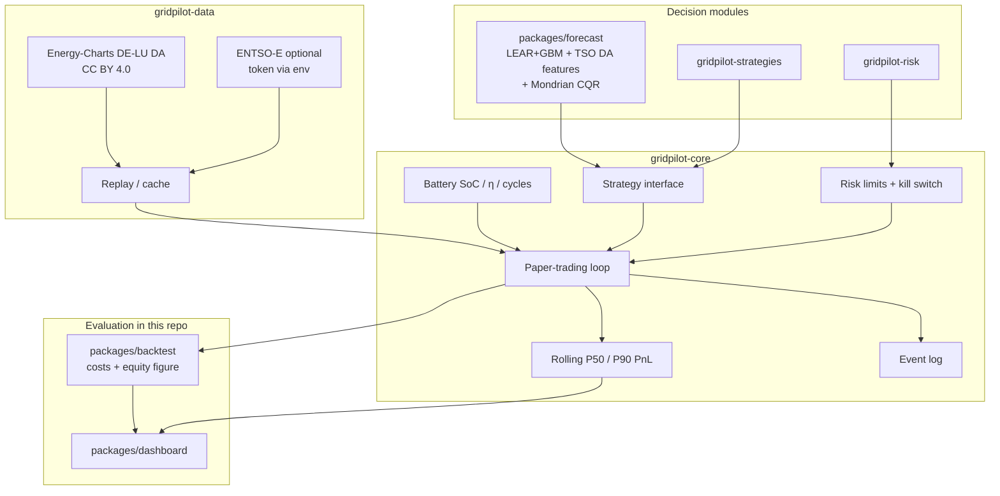

# GridPilot

**Open paper-trading agent stack for electricity markets** — live/near-live public data, pluggable charge/discharge strategies, risk limits, probabilistic P10/P50/P90 outcome tracking, ML forecasting, walk-forward backtests, and a Streamlit dashboard.

GridPilot is one public GitHub project ([this repo](https://github.com/DataWithSyed/gridpilot)) with **module packages** under `packages/` plus linked sibling repos for core/data/risk/strategies.

> **Paper trading only.** Nothing in GridPilot places real orders on any power exchange or broker. There is no live execution path in the public code.

## Why this exists

Battery storage and flexible demand need an **agent loop**: observe the market → forecast → decide under risk limits → simulate fills → learn. Prior single-repo studies under [@DataWithSyed](https://github.com/DataWithSyed) already cover forecasting, reserve stacking, LCOS, and lab data. GridPilot **links** those ideas into a coherent agent architecture instead of duplicating them.

## Architecture



## Roadmap

- [x] **Umbrella** (`gridpilot`): architecture, methods, assumptions, contributing *(this repo)*
- [x] **Core runtime** ([`gridpilot-core`](https://github.com/DataWithSyed/gridpilot-core)): battery · strategies · paper loop · Energy-Charts replay · risk limits · P50/P90
- [x] **Data adapters** ([`gridpilot-data`](https://github.com/DataWithSyed/gridpilot-data)): Energy-Charts live/near-live + replay + optional ENTSO-E env-token adapter
- [x] **Forecasting** (`packages/forecast`): LEAR-lite + quantile GBM + **day-ahead load/solar/wind** features + rolling / **Mondrian** CQR; links `de-day-ahead-price-forecasting` / `de-wind-probabilistic-forecasting`
- [x] **Risk engine** ([`gridpilot-risk`](https://github.com/DataWithSyed/gridpilot-risk)): block-bootstrap scenario PnL, VaR / CVaR, limit hooks
- [x] **Strategy pack** ([`gridpilot-strategies`](https://github.com/DataWithSyed/gridpilot-strategies)): forecast-driven + risk-aware LP (climatology baseline)
- [x] **Backtest harness** (`packages/backtest`): walk-forward table, **fees/slippage/degradation** cost layer, equity + coverage figures, cost-sensitivity sweep
- [x] **Dashboard** (`packages/dashboard`): Streamlit ops view (testable package + thin `app.py`)
- [x] **Near-live paper pilot** (`packages/live` + `results/live`): latest DE-LU fetch, ex-ante 14-day paper trade, forecast accuracy, next-day schedule

## Repo layout

```
gridpilot/
  packages/forecast/     # probabilistic DA price forecasts + ML strategies
  packages/backtest/     # comparison harness + CLI
  packages/dashboard/    # Streamlit UI
  packages/live/         # near-live paper pilot + accuracy check
  results/live/          # committed live-pilot summaries
  docs/                  # methods, assumptions, limitations
```

Sibling module repos (unchanged, linked): `gridpilot-core`, `gridpilot-data`, `gridpilot-risk`, `gridpilot-strategies`.

## Measured results so far (real runs)

### Primary window: **2025-11-01 → 2026-10-30** (~12 months) — **net of ASSUMED costs**

DE-LU day-ahead prices + DE day-ahead load/solar/wind forecasts via Energy-Charts (CC BY 4.0), hourly means, illustrative **1 MW / 2 MWh** BESS. Paper trading only. ML lookback **90** days, refit every **7** days (ASSUMED).

**Base costs (ASSUMED, labelled in `docs/assumptions.md`):** trading fee **0.05** €/MWh · slippage **0.50** €/MWh · degradation **5** €/MWh throughput. Strategies are **not** re-optimised for fees (accounting layer on fills).

| Metric | Value |
|---|---|
| Hours / DA mean | **8,735** h · **110.88** €/MWh (min −499 · max 697.31 · **5.17%** negative) |
| Forecast MAE | Ensemble+fundamentals **16.26** vs naive **33.98** €/MWh |
| 80% coverage | Raw **50.0%** → rolling CQR **72.2%** → **Mondrian CQR 78.2%** (nominal 80%; still slightly short) |
| Reliability (Mondrian) | P10 **8.2%** · P50 **46.5%** · P90 **86.4%** (rolling CQR was 8.8 / 40.7 / 81.0) |

| Strategy (net of base costs) | Final cash € | Capture of PF | Daily PnL P10 / P50 / P90 € | CVaR₅% loss € | Max DD € | Δ€/day vs thr. (90% CI) |
|---|---:|---:|---|---:|---:|---|
| Threshold | 31,944 | 44.2% | −61.74 / 76.78 / 247.22 | 175.43 | 309 | — |
| ForecastDrivenLP (climatology) | 33,932 | 47.0% | −54.25 / 51.62 / 300.21 | 178.83 | 434 | +5.5 [−5.5, 15.9] *(CI crosses 0)* |
| RiskAwareForecastLP (climatology) | 26,860 | 37.2% | −5.59 / 26.01 / 238.50 | 114.29 | 455 | −14.0 [−25.0, −4.5] |
| **MLForecastDrivenLP** (fund+rolling CQR) | **57,153** | **79.2%** | 0.00 / 135.30 / 362.07 | 79.79 | 466 | **+69.3 [53.3, 82.1]** |
| ML MondrianForecastDrivenLP | 55,501 | 76.9% | −5.48 / 125.88 / 363.69 | 81.99 | 460 | +64.7 [49.2, 79.0] |
| MLRiskAwareForecastLP | 45,566 | 63.1% | 0.00 / 93.47 / 292.63 | **43.06** | 455 | +37.4 [25.1, 48.1] |
| Perfect foresight (oracle) | 72,192 | 100% | 26.91 / 177.22 / 396.57 | 9.23 | 495 | +110.6 [91.7, 124.9] |

**Gross (zero fee/slip/deg) for honesty:** threshold **36,334** € · ML **68,822** € · Mondrian-ML **67,508** € · PF **85,231** €. Prior README cash (~65,497 ML) matched the fee=0 / slip=0 / deg=5 case (± rounding), not a zero-cost world.

**Cost sensitivity (ML vs threshold final cash €):**

| Scenario | fee / slip / deg | Threshold | ML | ML / thr |
|---|---|---:|---:|---:|
| zero | 0 / 0 / 0 | 36,334 | 68,822 | **1.89×** |
| fee_deg | 0.05 / 0 / 5 | 32,340 | 58,204 | **1.80×** |
| **base** | **0.05 / 0.50 / 5** | **31,944** | **57,153** | **1.79×** |
| stress | 0.10 / 1.0 / 10 | 27,555 | 45,483 | **1.65×** |

Honest takeaway: **the ML edge survives ASSUMED fees, slippage and degradation** — even under the stress case ML stays ~1.65× threshold, and the base 90% block-bootstrap CI on Δ€/day vs threshold **excludes zero**. Mondrian/regime-conditional CQR lifts 80% coverage **72.2 → 78.2%** and moves P50 reliability **40.7 → 46.5%** (closer to nominal 50%), but still short of exact 80%/50%. Mondrian-calibrated ML cash is slightly **below** rolling-CQR ML on this window (55.5k vs 57.2k net) — calibration quality ≠ automatic PnL gain. Equity curve: [`packages/backtest/figures/equity_curve_net.png`](packages/backtest/figures/equity_curve_net.png). Coverage plot: [`packages/backtest/figures/coverage_calibration.png`](packages/backtest/figures/coverage_calibration.png). Optional FCR overlay remains a **link only** to [`de-bess-reserve-revenue-stacking`](https://github.com/DataWithSyed/de-bess-reserve-revenue-stacking) (not co-optimised here). Still **paper trading only**.

### Earlier short window (kept for continuity): 2026-08-01 → 2026-10-15

Price-only ML on **1,824** h: threshold **9,993** € · climatology LP **14,145** € · ML **14,358** € · PF **25,228** € (ML **56.9%** of PF). That short sample understated the value of fundamentals.

### Near-live paper pilot (2026-11-10 Asia/Karachi)

Ran against the latest published Energy-Charts DE-LU day-ahead curve (**2026-10-28 → 2026-11-10**, 14 days / 336 h). Decisions for each delivery day were locked from information available **before** that day (ex-ante P50 forecast → daily LP); fills settled at realised DA. Paper trading only — **no real orders**.

| Check | Result |
|---|---|
| Forecast MAE | ML+fund+CQR **39.20** vs naive **75.68** €/MWh |
| Forecast RMSE | ML **46.89** vs naive **84.12** €/MWh |
| P10–P90 coverage | **52.4%** (nominal 80%) |
| ML ex-ante LP cash | **3,352** € (**87.0%** of PF **3,853** €) |
| Threshold cash | 1,051 € |
| Next delivery day | **2026-11-11** (DA not yet published): forecast-only schedule, 4h charge / 4h discharge / 16h hold, P50 mean **351.48** €/MWh |

What this validates: ex-ante DA forecast skill, interval coverage, paper capture of a forecast-based daily LP. What it does **not**: real orders, SDAC bids before gate closure, intraday/imbalance/ancillary, fees/slippage. Details: [`results/live/LIVE_PILOT.md`](results/live/LIVE_PILOT.md).

### Module highlights

| Module | Highlight |
|---|---|
| [`gridpilot-core`](https://github.com/DataWithSyed/gridpilot-core) | Battery · paper loop · P50/P90 · kill switch |
| [`gridpilot-data`](https://github.com/DataWithSyed/gridpilot-data) | Energy-Charts adapters + optional ENTSO-E env token |
| [`gridpilot-risk`](https://github.com/DataWithSyed/gridpilot-risk) | Block-bootstrap VaR/CVaR hooks |
| [`gridpilot-strategies`](https://github.com/DataWithSyed/gridpilot-strategies) | Climatology ForecastDrivenLP / RiskAwareForecastLP |
| `packages/forecast` | Fundamentals + rolling / Mondrian CQR; long-window + costs eval scripts |
| `packages/backtest` | Cost layer, sensitivity CSV, equity + coverage figures, bootstrap CI |
| `packages/dashboard` | Streamlit: net table, calibration, bootstrap CIs, equity image |

## Quick start

```bash
# sibling checkouts beside this repo recommended
git clone https://github.com/DataWithSyed/gridpilot.git
git clone https://github.com/DataWithSyed/gridpilot-core.git
git clone https://github.com/DataWithSyed/gridpilot-strategies.git

cd gridpilot
python -m venv .venv && source .venv/bin/activate
pip install -e packages/forecast -e packages/backtest -e "packages/dashboard[ui]"
pip install -e ../gridpilot-core -e ../gridpilot-strategies

pytest -q packages/forecast packages/backtest packages/dashboard
# rebuild fundamentals cache if needed (API rate-limited):
# python packages/forecast/scripts/fetch_fundamentals.py --start 2025-11-01 --end 2026-10-30
python packages/forecast/scripts/run_long_window_eval.py
python packages/forecast/scripts/run_costs_mondrian_equity.py  # fees/slip/deg + Mondrian + equity
python packages/dashboard/scripts/healthcheck.py
streamlit run packages/dashboard/app.py
```

## Related work

See [`docs/related-work.md`](docs/related-work.md). Highlights:

- [de-day-ahead-price-forecasting](https://github.com/DataWithSyed/de-day-ahead-price-forecasting)
- [de-bess-reserve-revenue-stacking](https://github.com/DataWithSyed/de-bess-reserve-revenue-stacking)
- [epm-data-pipeline](https://github.com/DataWithSyed/epm-data-pipeline) · [eu-power-market-lab](https://github.com/DataWithSyed/eu-power-market-lab)
- [bess-lcos-montecarlo-irr](https://github.com/DataWithSyed/bess-lcos-montecarlo-irr)

## Docs

- [`docs/methods.md`](docs/methods.md) — literature anchors (DOIs)
- [`docs/assumptions.md`](docs/assumptions.md) — labelled ASSUMED defaults
- [`docs/limitations.md`](docs/limitations.md) — honest scope limits
- [`CONTRIBUTING.md`](CONTRIBUTING.md) — how to help
- [`docs/issue-templates/`](docs/issue-templates/) — bug / feature templates

## Licence

MIT for code and documentation in this umbrella. Upstream market data keep their own licences — always attribute (Energy-Charts / SMARD, and others as added).
