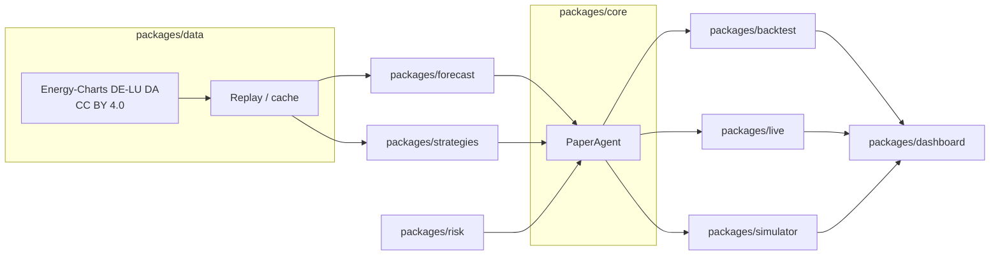

# GridPilot

**Open paper-trading agent stack for electricity markets.** One public repository ([DataWithSyed/gridpilot](https://github.com/DataWithSyed/gridpilot)): public data in, a forecast, a risk-limited schedule or bid curve, and paper evaluation out.

Version **0.4.0**. Documentation index: [`docs/index.md`](docs/index.md).

> **Paper trading only.** GridPilot does **not** connect to a power exchange or broker, does **not** place or sign real orders, and does **not** claim real-money performance. The “live” package is a near-live **paper** pilot on public Energy-Charts prices. Star counts are not a project goal in these docs.

## What it is (and is not)

**It is** a research stack for a German DE-LU day-ahead paper battery (illustrative **1 MW / 2 MWh**): Energy-Charts / SMARD prices and day-ahead load/solar/wind forecasts, walk-forward P10/P50/P90 forecasting, cost-aware and CVaR dispatch LPs, SDAC-style bid curves, a labelled post-DA re-optimisation layer, walk-forward backtests, a tick simulator, and a Streamlit view.

**It is not** an execution venue, an EMS product with live order routing, or a measured intraday / official reBAP study. Published coverage is still **below 80%**. Degradation is still an **ASSUMED 5 €/MWh**. Gate-closure bid curves **under-cycled** versus a locked schedule. Those limits are documented, not papered over.

## Architecture

Public data flow through the packages in this order: **data → forecast → risk → strategies → backtest / live / simulator → dashboard**. `packages/core` is the shared paper runtime (battery, strategy interface, limits).



Day-ahead decisions for delivery day **D** are locked at **12:00 Europe/Berlin on D-1**. Forecasts do not see realised D prices. Perfect foresight is an oracle baseline only. Design detail: [`docs/ARCHITECTURE.md`](docs/ARCHITECTURE.md), methods: [`docs/METHODOLOGY.md`](docs/METHODOLOGY.md).

## Packages

Install once from the repo root. Entry points below assume `pip install -e ".[dev,ui]"`.

| Package | Purpose | Entry points / CLI |
| --- | --- | --- |
| [`packages/data`](packages/data/README.md) | Energy-Charts, replay, optional ENTSO-E adapters | Library (`EnergyChartsAdapter`, `ReplayAdapter`) |
| [`packages/forecast`](packages/forecast/README.md) | LEAR-lite + quantile GBM, CQR, cost-aware / CVaR LPs, bid curves, ID layer | Scripts under `packages/forecast/scripts/` (e.g. `run_cost_aware_tight_mondrian.py`) |
| [`packages/risk`](packages/risk/README.md) | Block-bootstrap scenario cash, historical VaR / CVaR, limit hooks | Library |
| [`packages/strategies`](packages/strategies/README.md) | Climatology forecast-driven and risk-aware LPs | Library |
| [`packages/core`](packages/core/README.md) | Battery physics, `Strategy` protocol, `PaperAgent`, cycle / drawdown limits | Library |
| [`packages/backtest`](packages/backtest/README.md) | Walk-forward harness, sourced fees, equity figures | `gridpilot-backtest` |
| [`packages/live`](packages/live/README.md) | Near-live ex-ante paper pilot and next-day schedule | `gridpilot-live-pilot` · `packages/live/scripts/run_live_pilot.py` |
| [`packages/simulator`](packages/simulator/README.md) | Tick-by-tick paper replay, Streamlit, HTML/PNG report, Docker | `gridpilot-sim run` · `gridpilot-sim dashboard` · `gridpilot-sim report` |
| [`packages/dashboard`](packages/dashboard/README.md) | Streamlit ops view of backtest / calibration outputs | `streamlit run packages/dashboard/app.py` |

## Consolidated results (paper only)

Figures are copied from committed result files. Full tables, hour counts, and caveats: [`docs/RESULTS.md`](docs/RESULTS.md). Primary historical window: **2025-11-01 → 2026-10-30**, DE-LU day-ahead, illustrative 1 MW / 2 MWh BESS. Some later experiments on that calendar use **8,736** h rather than **8,735** h and are **not** a re-run of the headline ML path.

| Result | Window | Headline (paper cash) | Source |
| --- | --- | --- | --- |
| **Cost-aware ML vs threshold vs perfect foresight** (sourced fees) | 2025-11-01 → 2026-10-30, **8,735** h | Threshold **32,367** €; cost-aware ML **65,473** € (**79.6%** of cost-aware PF **82,271** €); Δ vs threshold **+90.9 [76.6, 104.7]** €/day | [`sourced_fees_backtest.json`](packages/forecast/results/sourced_fees_backtest.json) |
| **Live pilot accuracy** | **2026-10-28 → 2026-11-10**, 14 d / 336 h (re-run **2026-11-10**) | MAE **39.20** vs naive **75.68** €/MWh; coverage **52.4%**; ML net **3,351** € (**87.0%** of PF net **3,852**) | [`results/live/LIVE_PILOT.md`](results/live/LIVE_PILOT.md) |
| **Bid curves (negative result)** | Same 12-month calendar, **8,736** h, same-fan comparison | Climatology lock **60,379** vs quantile bids **13,082** (€/day **−129.94 [−149.98, −107.28]**). Curves under-cycled. Not comparable to the 65,473 € path | [`GATE_CLOSURE_BIDDING.md`](packages/forecast/results/GATE_CLOSURE_BIDDING.md) |
| **Intraday / imbalance — proxy-only** | Same climatology DA lock | Full ID close **83,394** € (**+23,015**; **+63.23 [52.36, 73.28]** €/day) under **PROXY_ID_EQ_DA**. No public ID or official reBAP series | [`INTRADAY_IMBALANCE.md`](packages/forecast/results/INTRADAY_IMBALANCE.md) |
| **CVaR frontier** | Same calendar, **8,736** h, last 60 causal paths | λ = 0: **69,622** / CVaR **18.56**; λ = 2: **66,718** / **6.34**; **λ = 5 did not beat λ = 2** (CVaR **6.68**). Not a re-run of 65,473 € | [`CVAR_FRONTIER.md`](packages/forecast/results/CVAR_FRONTIER.md) |

On the same 8,735 h window, tight Mondrian lifted 80% coverage to **78.9%** (still short of 80%) but did **not** raise cost-aware ML cash versus rolling CQR (sourced: **65,312** vs **65,473** €). Cost-aware ML paid **€8,219** degradation versus **€25** fees under the sourced preset.

Equity and coverage plots: [`packages/backtest/figures/equity_curve_net.png`](packages/backtest/figures/equity_curve_net.png), [`packages/backtest/figures/coverage_calibration.png`](packages/backtest/figures/coverage_calibration.png).

## Quickstart

```bash
python -m venv .venv && source .venv/bin/activate
pip install -e ".[dev,ui]"
pytest -q
```

Paper simulator (synthetic demo, seed 0; not the 12-month backtest):

```bash
gridpilot-sim run --scenario normal --speed 0 --seed 0
gridpilot-sim dashboard
# or
./packages/simulator/scripts/quickstart.sh
```

Policies on the simulator include `--policy cost_aware` (default), `quantile_bids`, `cvar`, and `id_reopt`. See [`docs/SIMULATOR.md`](docs/SIMULATOR.md).

Docker (paper simulator + dashboard on port 8502):

```bash
docker build -t gridpilot-sim -f packages/simulator/Dockerfile .
docker run --rm -p 8502:8502 gridpilot-sim
```

Other CLIs after the same install: `gridpilot-backtest`, `gridpilot-live-pilot` (or `python packages/live/scripts/run_live_pilot.py`). Heavy 12-month walk-forwards are optional; prefer the committed files linked above when you only need the published numbers.

## Data sources and licences

- **Prices and day-ahead load / solar / wind forecasts:** [Energy-Charts](https://www.energy-charts.info/) / SMARD (Bundesnetzagentur, published via Fraunhofer ISE). Licence: [CC BY 4.0](https://creativecommons.org/licenses/by/4.0/). Always attribute.
- **Optional ENTSO-E:** `EntsoeAdapter` reads `ENTSOE_API_TOKEN` from the environment only. Never commit a token.
- **Code and documentation:** MIT (see [`LICENSE`](LICENSE)). Upstream market data keep their own licences.

## Sourced fee table (retrieval 2026-11-10, Asia/Karachi)

Default paper preset: `get_cost_preset("sourced")`. Full citations and items that were **not found**: [`docs/fees.md`](docs/fees.md).

| Item | Status | Figure | Source (retrieved 2026-11-10) |
| --- | --- | --- | --- |
| ECC Lux DA spot **clearing** | Sourced | **0.015 €/MWh** | [ECC Price List 085b, 2 Nov 2026](https://www.ecc.de/fileadmin/ECC/Downloads/About_ECC_AG/Rules/Price_List/Current_Price_List/20261102_ECC_Price_List_085b.pdf) §4.1 |
| DA slippage | Sourced (market design) | **0 €/MWh** | SDAC single clearing price per MTU |
| Battery degradation | **ASSUMED** | **5 €/MWh** throughput | No public €/MWh wear tariff; see fees.md |
| EPEX SPOT DA **trading** fee | **Not found** in current public docs | omitted (lower bound) | [EPEX Fees](https://www.epexspot.com/en/fees), [Price List Guide](https://www.epexspot.com/sites/default/files/download_center_files/New%20Price%20List%20Guide.pdf) |
| ECC ID / SIDC IDA clearing | Sourced, used in the ID layer only | 0.035 €/MWh | Same ECC 085b §4.1 |
| Grid access on stored energy | Sourced, conditional | **0 €/MWh** if eligible | [EnWG § 118(6)](https://www.gesetze-im-internet.de/enwg_2005/__118.html) |
| Official reBAP | Not applied | no series in the published runs | Netztransparenz OAuth; not fetchable |
| Nord Pool DA trading + clearing | Sourced **comparator only** (not in the preset) | 0.055 €/MWh | [Nord Pool Fee Schedule 2026](https://www.nordpoolgroup.com/4a7ad8/globalassets/trading-and-services/nord-pool-fee-schedule-2026-nordic-and-baltic-market.pdf) (Nordic/Baltic PDF; not used as EPEX DE-LU) |

The sourced variable fee is **ECC clearing only**. Real all-in exchange costs may be higher once a current EPEX trading fee and annual membership are included. This is not a quote from EPEX, ECC, or a TSO.

## Limitations and roadmap

**Limitations** (see also [`docs/limitations.md`](docs/limitations.md)):

- Paper trading only — no exchange connectivity, no real orders, no real-money claims.
- Nominal 80% forecast coverage is still **below 80%** (tight Mondrian **78.9%** on the 12-month window; live pilot **52.4%**).
- **No public intraday or official reBAP data** in the published runs; the ID result is **proxy-only**.
- Degradation stays an **ASSUMED 5 €/MWh** and dominates the cost line.
- Gate-closure bid curves **under-cycled** and lost money versus the locked schedule (CIs exclude 0).
- Sourced DA fee omits the unpublished current EPEX trading fee (lower bound).
- Bid-curve, ID, and CVaR cash are not substitutes for the published cost-aware ML **65,473 €** path.
- On the CVaR frontier, **λ = 5 did not** improve out-of-sample CVaR versus λ = 2.

**Roadmap** (honest, not a promise):

- [ ] Public ID-index or official reBAP series, if and when they can be fetched without inventing a proxy.
- [ ] Calibration work that actually reaches 80% coverage — and a check of whether that changes paper profit (it has not so far).
- [ ] Bid-curve designs that do not systematically under-cycle, or a clear decision to drop the approach.
- [ ] A sourced (not assumed) degradation or wear model if a defensible public figure appears.
- [ ] Current EPEX DE-LU trading fee, if it is published.
- [x] Umbrella monorepo, core runtime, data, forecast, risk, strategies, backtest, dashboard, live paper pilot, simulator.
- [x] Cost-aware LP, sourced fee catalog, gate-closure bids (negative), ID proxies, CVaR frontier, simulator hooks.

## Further documentation

| Page | Contents |
| --- | --- |
| [`docs/index.md`](docs/index.md) | Full docs index |
| [`docs/ARCHITECTURE.md`](docs/ARCHITECTURE.md) | Data flow and key classes |
| [`docs/METHODOLOGY.md`](docs/METHODOLOGY.md) | Forecast, LPs, SDAC timing, bootstrap CIs |
| [`docs/RESULTS.md`](docs/RESULTS.md) | Complete result tables and source files |
| [`docs/fees.md`](docs/fees.md) | Sourced vs assumed costs |
| [`docs/BIDDING.md`](docs/BIDDING.md) · [`docs/INTRADAY.md`](docs/INTRADAY.md) · [`docs/CVAR.md`](docs/CVAR.md) · [`docs/SIMULATOR.md`](docs/SIMULATOR.md) | Design notes |
| [`docs/GLOSSARY.md`](docs/GLOSSARY.md) · [`docs/FAQ.md`](docs/FAQ.md) | Terms and short answers |
| [`CHANGELOG.md`](CHANGELOG.md) · [`CONTRIBUTING.md`](CONTRIBUTING.md) | History and how to help |

## Licence

MIT for code and documentation. Energy-Charts / SMARD data remain [CC BY 4.0](https://creativecommons.org/licenses/by/4.0/) — always attribute.
