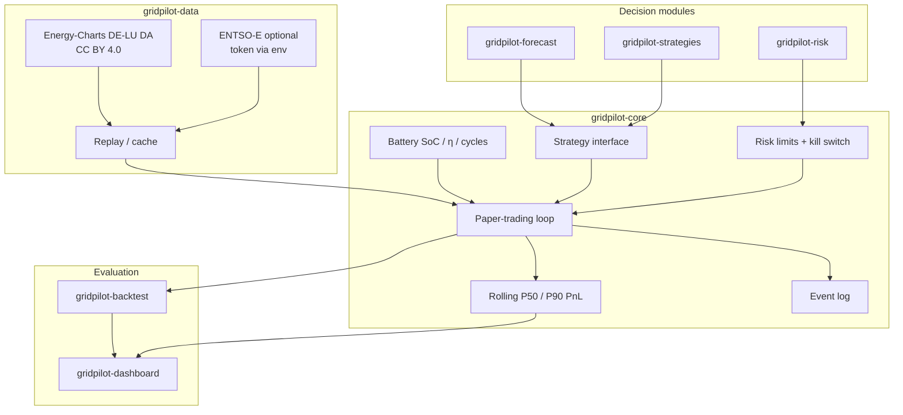

# GridPilot

**Open paper-trading agent stack for electricity markets** — live/near-live public data, pluggable charge/discharge strategies, risk limits, probabilistic P50/P90 outcome tracking, forecasting hooks, and backtests.

GridPilot is a **multi-repo** system. This umbrella holds architecture, roadmap, and docs. Executable code lives in the module repos.

> **Paper trading only.** Nothing in GridPilot places real orders on any power exchange or broker. There is no live execution path in the public code.

## Why this exists

Battery storage and flexible demand need an **agent loop**: observe the market → forecast → decide under risk limits → simulate fills → learn. Prior single-repo studies under [@DataWithSyed](https://github.com/DataWithSyed) already cover forecasting, reserve stacking, LCOS, and lab data. GridPilot **links** those ideas into a coherent agent architecture instead of duplicating them.

## Architecture



## Roadmap

- [x] **Umbrella** (`gridpilot`): architecture, methods, assumptions, contributing *(this repo)*
- [x] **Core runtime** ([`gridpilot-core`](https://github.com/DataWithSyed/gridpilot-core)): battery · strategies · paper loop · Energy-Charts replay · risk limits · P50/P90
- [ ] **Data adapters** (`gridpilot-data`): pluggable live/near-live feeds, ENTSO-E env-token adapter, richer replay
- [ ] **Forecasting** (`gridpilot-forecast`): price / renewable probabilistic forecasts (links `de-day-ahead-price-forecasting`, `de-wind-probabilistic-forecasting`)
- [ ] **Risk engine** (`gridpilot-risk`): scenario PnL, VaR / CVaR, stress tests beyond core limits
- [ ] **Strategy pack** (`gridpilot-strategies`): forecast-driven, stochastic, reserve-stacking hooks (links `de-bess-reserve-revenue-stacking`)
- [ ] **Backtest harness** (`gridpilot-backtest`): walk-forward reports with P50/P90
- [ ] **Dashboard** (`gridpilot-dashboard`): Streamlit ops view

## Quick start (core)

```bash
git clone https://github.com/DataWithSyed/gridpilot-core.git
cd gridpilot-core
python -m venv .venv && source .venv/bin/activate
pip install -e ".[dev]"
python scripts/run_paper_trade.py --start 2026-08-01 --end 2026-10-15
pytest -q
```

## Related work

See [`docs/related-work.md`](docs/related-work.md). Highlights:

- [de-day-ahead-price-forecasting](https://github.com/DataWithSyed/de-day-ahead-price-forecasting)
- [de-bess-reserve-revenue-stacking](https://github.com/DataWithSyed/de-bess-reserve-revenue-stacking)
- [epm-data-pipeline](https://github.com/DataWithSyed/epm-data-pipeline) · [eu-power-market-lab](https://github.com/DataWithSyed/eu-power-market-lab)
- [bess-lcos-montecarlo-irr](https://github.com/DataWithSyed/bess-lcos-montecarlo-irr)

## Docs

- [`docs/methods.md`](docs/methods.md) — literature anchors (DOIs)
- [`docs/assumptions.md`](docs/assumptions.md) — labelled ASSUMED defaults
- [`docs/limitations.md`](docs/limitations.md) — honest scope limits
- [`CONTRIBUTING.md`](CONTRIBUTING.md) — how to help
- [`docs/issue-templates/`](docs/issue-templates/) — bug / feature templates

## Licence

MIT for code and documentation in this umbrella. Upstream market data keep their own licences — always attribute (Energy-Charts / SMARD, and others as added).
