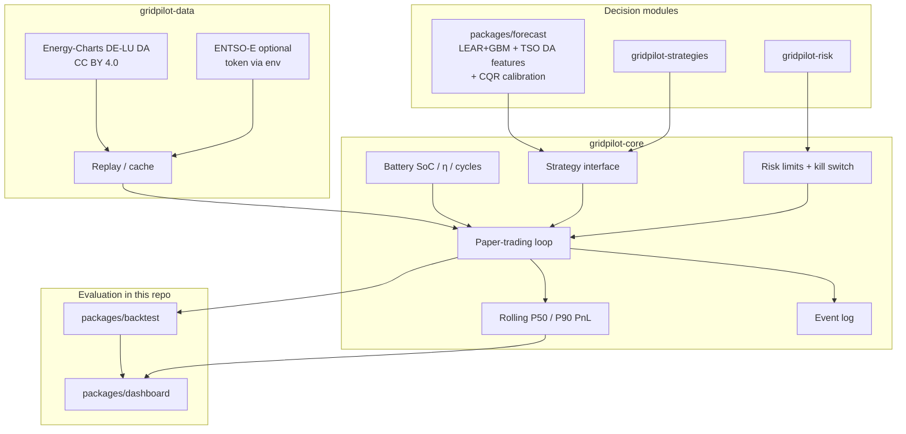

# GridPilot

**Open paper-trading agent stack for electricity markets** — live/near-live public data, pluggable charge/discharge strategies, risk limits, probabilistic P10/P50/P90 outcome tracking, ML forecasting, walk-forward backtests, and a Streamlit dashboard.

GridPilot is one public GitHub project ([this repo](https://github.com/DataWithSyed/gridpilot)) with **module packages** under `packages/` plus linked sibling repos for core/data/risk/strategies.

> **Paper trading only.** Nothing in GridPilot places real orders on any power exchange or broker. There is no live execution path in the public code.

## Why this exists

Battery storage and flexible demand need an **agent loop**: observe the market → forecast → decide under risk limits → simulate fills → learn. Prior single-repo studies under [@DataWithSyed](https://github.com/DataWithSyed) already cover forecasting, reserve stacking, LCOS, and lab data. GridPilot **links** those ideas into a coherent agent architecture instead of duplicating them.

## Architecture



## Roadmap

- [x] **Umbrella** (`gridpilot`): architecture, methods, assumptions, contributing *(this repo)*
- [x] **Core runtime** ([`gridpilot-core`](https://github.com/DataWithSyed/gridpilot-core)): battery · strategies · paper loop · Energy-Charts replay · risk limits · P50/P90
- [x] **Data adapters** ([`gridpilot-data`](https://github.com/DataWithSyed/gridpilot-data)): Energy-Charts live/near-live + replay + optional ENTSO-E env-token adapter
- [x] **Forecasting** (`packages/forecast`): LEAR-lite + quantile GBM + **day-ahead load/solar/wind** features + rolling CQR; links `de-day-ahead-price-forecasting` / `de-wind-probabilistic-forecasting`
- [x] **Risk engine** ([`gridpilot-risk`](https://github.com/DataWithSyed/gridpilot-risk)): block-bootstrap scenario PnL, VaR / CVaR, limit hooks
- [x] **Strategy pack** ([`gridpilot-strategies`](https://github.com/DataWithSyed/gridpilot-strategies)): forecast-driven + risk-aware LP (climatology baseline)
- [x] **Backtest harness** (`packages/backtest`): walk-forward comparison table, CLI, equity figure
- [x] **Dashboard** (`packages/dashboard`): Streamlit ops view (testable package + thin `app.py`)
- [x] **Near-live paper pilot** (`packages/live` + `results/live`): latest DE-LU fetch, ex-ante 14-day paper trade, forecast accuracy, next-day schedule

## Repo layout

```
gridpilot/
  packages/forecast/     # probabilistic DA price forecasts + ML strategies
  packages/backtest/     # comparison harness + CLI
  packages/dashboard/    # Streamlit UI
  packages/live/         # near-live paper pilot + accuracy check
  results/live/          # committed live-pilot summaries
  docs/                  # methods, assumptions, limitations
```

Sibling module repos (unchanged, linked): `gridpilot-core`, `gridpilot-data`, `gridpilot-risk`, `gridpilot-strategies`.

## Measured results so far (real runs)

### Primary window: **2025-11-01 → 2026-10-30** (~12 months)

DE-LU day-ahead prices + DE day-ahead load/solar/wind forecasts via Energy-Charts (CC BY 4.0), hourly means, illustrative **1 MW / 2 MWh** BESS. Paper trading only; no fees/slippage. ML lookback **90** days, refit every **7** days (ASSUMED). CQR α=0.20, window 60 d, delay 2.

| Metric | Value |
|---|---|
| Hours / DA mean | **8,735** h · **110.88** €/MWh (min −499 · max 697.31 · **5.17%** negative) |
| Forecast MAE | Ensemble+fundamentals **16.26** vs naive **33.98** €/MWh (337–340 days) |
| 80% coverage | Raw **50.0%** → CQR **72.2%** (still short of nominal 80%) |
| Reliability (CQR) | P10 **8.8%** · P50 **40.7%** · P90 **81.0%** (nominal 10/50/90) |

| Strategy | Final cash € | Capture of PF | Daily PnL P10 / P50 / P90 € | CVaR₅% loss € | Max DD € | Δ€/day vs thr. (90% CI) |
|---|---:|---:|---|---:|---:|---|
| Threshold | 32,379 | 39.3% | −59.32 / 82.07 / 249.06 | 174.22 | 307 | — |
| ForecastDrivenLP (climatology) | 42,655 | 51.8% | −3.60 / 81.97 / 289.62 | 63.32 | 460 | +28.1 [19.8, 37.8] |
| RiskAwareForecastLP (climatology) | 34,518 | 41.9% | 0.00 / 38.03 / 267.04 | 5.48 | 455 | +5.7 [−5.6, 16.1] *(CI crosses 0)* |
| **MLForecastDrivenLP** (fund+CQR) | **65,497** | **79.6%** | 13.65 / 174.56 / 344.01 | 13.04 | 458 | **+91.0 [77.5, 104.5]** |
| MLRiskAwareForecastLP (fund+CQR) | 52,665 | 64.0% | 0.00 / 129.42 / 303.34 | **1.30** | 455 | +55.7 [44.3, 66.8] |
| Perfect foresight (oracle) | 82,301 | 100% | 37.77 / 224.72 / 400.80 | n/a | 494 | +137.1 [119.8, 151.8] |

Honest takeaway: with **day-ahead fundamentals** and a **12-month** window, ML captures **~80%** of perfect-foresight cash and roughly **doubles** the simple threshold rule; the 90% block-bootstrap CI on the daily edge vs threshold excludes zero. CQR lifts interval coverage but does **not** yet hit the nominal 80%. Risk-aware ML trades ~20 pp of capture for near-zero CVaR₅%. Still paper trading: no fees, no slippage, no live orders.

### Earlier short window (kept for continuity): 2026-08-01 → 2026-10-15

Price-only ML on **1,824** h: threshold **9,993** € · climatology LP **14,145** € · ML **14,358** € · PF **25,228** € (ML **56.9%** of PF). That short sample understated the value of fundamentals.

### Near-live paper pilot (2026-11-10 Asia/Karachi)

Ran against the latest published Energy-Charts DE-LU day-ahead curve (**2026-10-28 → 2026-11-10**, 14 days / 336 h). Decisions for each delivery day were locked from information available **before** that day (ex-ante P50 forecast → daily LP); fills settled at realised DA. Paper trading only — **no real orders**.

| Check | Result |
|---|---|
| Forecast MAE | ML+fund+CQR **39.20** vs naive **75.68** €/MWh |
| Forecast RMSE | ML **46.89** vs naive **84.12** €/MWh |
| P10–P90 coverage | **52.4%** (nominal 80%) |
| ML ex-ante LP cash | **3,352** € (**87.0%** of PF **3,853** €) |
| Threshold cash | 1,051 € |
| Next delivery day | **2026-11-11** (DA not yet published): forecast-only schedule, 4h charge / 4h discharge / 16h hold, P50 mean **351.48** €/MWh |

What this validates: ex-ante DA forecast skill, interval coverage, paper capture of a forecast-based daily LP. What it does **not**: real orders, SDAC bids before gate closure, intraday/imbalance/ancillary, fees/slippage. Details: [`results/live/LIVE_PILOT.md`](results/live/LIVE_PILOT.md).

### Module highlights

| Module | Highlight |
|---|---|
| [`gridpilot-core`](https://github.com/DataWithSyed/gridpilot-core) | Battery · paper loop · P50/P90 · kill switch |
| [`gridpilot-data`](https://github.com/DataWithSyed/gridpilot-data) | Energy-Charts adapters + optional ENTSO-E env token |
| [`gridpilot-risk`](https://github.com/DataWithSyed/gridpilot-risk) | Block-bootstrap VaR/CVaR hooks |
| [`gridpilot-strategies`](https://github.com/DataWithSyed/gridpilot-strategies) | Climatology ForecastDrivenLP / RiskAwareForecastLP |
| `packages/forecast` | Fundamentals + CQR; long-window eval script |
| `packages/backtest` | Comparison CSV/JSON + bootstrap CI helper |
| `packages/dashboard` | Streamlit view of long-window table, calibration, bootstrap CIs |

## Quick start

```bash
# sibling checkouts beside this repo recommended
git clone https://github.com/DataWithSyed/gridpilot.git
git clone https://github.com/DataWithSyed/gridpilot-core.git
git clone https://github.com/DataWithSyed/gridpilot-strategies.git

cd gridpilot
python -m venv .venv && source .venv/bin/activate
pip install -e packages/forecast -e packages/backtest -e "packages/dashboard[ui]"
pip install -e ../gridpilot-core -e ../gridpilot-strategies

pytest -q packages/forecast packages/backtest packages/dashboard
# rebuild fundamentals cache if needed (API rate-limited):
# python packages/forecast/scripts/fetch_fundamentals.py --start 2025-11-01 --end 2026-10-30
python packages/forecast/scripts/run_long_window_eval.py
python packages/dashboard/scripts/healthcheck.py
streamlit run packages/dashboard/app.py
```

## Related work

See [`docs/related-work.md`](docs/related-work.md). Highlights:

- [de-day-ahead-price-forecasting](https://github.com/DataWithSyed/de-day-ahead-price-forecasting)
- [de-bess-reserve-revenue-stacking](https://github.com/DataWithSyed/de-bess-reserve-revenue-stacking)
- [epm-data-pipeline](https://github.com/DataWithSyed/epm-data-pipeline) · [eu-power-market-lab](https://github.com/DataWithSyed/eu-power-market-lab)
- [bess-lcos-montecarlo-irr](https://github.com/DataWithSyed/bess-lcos-montecarlo-irr)

## Docs

- [`docs/methods.md`](docs/methods.md) — literature anchors (DOIs)
- [`docs/assumptions.md`](docs/assumptions.md) — labelled ASSUMED defaults
- [`docs/limitations.md`](docs/limitations.md) — honest scope limits
- [`CONTRIBUTING.md`](CONTRIBUTING.md) — how to help
- [`docs/issue-templates/`](docs/issue-templates/) — bug / feature templates

## Licence

MIT for code and documentation in this umbrella. Upstream market data keep their own licences — always attribute (Energy-Charts / SMARD, and others as added).
