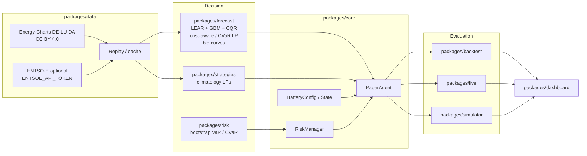

# Architecture

GridPilot is a **single public repository** ([DataWithSyed/gridpilot](https://github.com/DataWithSyed/gridpilot)). Former sibling repos live under `packages/` and install together from the root (`pip install -e ".[dev,ui]"`).

**Paper trading only.** There is no exchange or broker adapter that places orders. The live package and the simulator replay public prices and record paper fills.

## Data flow

Public market data enter through `packages/data` (or the forecast fundamentals cache). A walk-forward forecaster in `packages/forecast` builds a P10/P50/P90 fan with no lookahead into delivery-day prices. Strategies in `packages/strategies` and `packages/forecast` turn that fan into a day-ahead schedule (or a bid curve) under battery and risk limits from `packages/core`. Evaluation happens in `packages/backtest` (historical windows), `packages/live` (near-live paper pilot), and `packages/simulator` (tick replay). `packages/dashboard` and the simulator Streamlit app read those outputs.

Day-ahead schedules for delivery day **D** are locked at **12:00 Europe/Berlin on D-1** (SDAC gate closure). Forecasts for D use only information already published by that deadline. Realised D prices are used at settlement, not as inputs to that day's plan. Perfect foresight is an oracle baseline and is never fed back into the agent.

## Package responsibilities

| Package | Responsibility |
| --- | --- |
| `packages/data` | Price and public-power adapters; licence metadata |
| `packages/forecast` | Walk-forward P10/P50/P90, CQR, cost-aware and CVaR LPs, bid curves, ID/imbalance layer, eval scripts |
| `packages/risk` | Block-bootstrap scenario cash, historical VaR/CVaR, limit hooks |
| `packages/strategies` | Climatology forecast-driven and risk-aware LPs (pre-ML baselines) |
| `packages/core` | Battery physics, `Strategy` protocol, `PaperAgent`, risk limits, event log, P10/P50/P90 daily PnL |
| `packages/backtest` | Walk-forward harness, `ExecutionCosts`, sourced fee catalog, equity and coverage figures |
| `packages/live` | Near-live Energy-Charts fetch, ex-ante 14-day paper pilot, next-day schedule |
| `packages/simulator` | Tick-by-tick paper replay, scenarios, CLI, Streamlit, HTML/PNG report, Docker |
| `packages/dashboard` | Streamlit ops view of backtest and calibration outputs |

## Key interfaces and classes

Found in the installed packages (names only; see the source for signatures).

**Data.** `PriceAdapter` / `PowerAdapter` protocols (`gridpilot_data.base`). Implementations: `EnergyChartsAdapter`, `ReplayAdapter`, `EntsoeAdapter` (token from `ENTSOE_API_TOKEN` only). `SourceMeta` carries licence and attribution.

**Core.** `BatteryConfig` and `BatteryState`; `apply_dispatch` advances SoC with one-way efficiencies and clips to the SoC band and power rating. `Decision` is a charge/discharge pair plus a note. `Strategy` is a protocol whose `decide(...)` sees the current timestamp, a price, causal history, the battery, and optional remaining-day prices — never future realised prices unless the strategy is an explicitly labelled oracle. `ThresholdArbitrage` and `PerfectForesightDaily` are the core baselines. `PaperAgent` runs the paper loop. `RiskLimits` / `RiskManager` enforce cycle and drawdown caps and a kill switch. `EventLog` records paper events.

**Forecast.** `WalkForwardQuantileForecast` (lookback 90 days, refit every 7 days in the published 12-month runs; both windows are labelled ASSUMED). Models: `NaiveDayAhead`, `LEARLite`, `QuantileGBM`, `EnsembleQuantile`. Calibrators: `RollingCQR`, `MondrianAsymmetricCQR`. Dispatch: `solve_day_lp_with_costs`, `CostAwareForecastDrivenLP`, `MLCostAwareForecastDrivenLP`, `CostAwarePerfectForesightDaily`. Bidding: `HourBidCurve`, `build_quantile_bid_curve`, `evaluate_day`. Intraday: `IntradayLayerConfig`, `reoptimize_after_da`. Risk-aware LP: `solve_day_lp_cvar`, `historical_day_scenarios`.

**Backtest and costs.** `ExecutionCosts`, presets `SOURCED_COSTS` / `ASSUMED_BASE_COSTS` / `ZERO_COSTS`, `apply_costs_to_actions`, `get_cost_preset`. Metrics: `historical_cvar`, `block_bootstrap_mean_diff_ci`. `BacktestHarness` compares strategies. Fee citations live in `gridpilot_backtest.fees`.

**Risk package.** `RiskLimitSpec`, `KillSwitch`, plus bootstrap helpers used by strategy walk-forwards.

**Live and simulator.** `LivePilotConfig` and `packages/live/scripts/run_live_pilot.py`. `SimConfig`, `Simulator`, `SimClock`, `Scenario`; CLI `gridpilot-sim`. Policies: `cost_aware`, `quantile_bids`, `cvar`, `id_reopt`.

## What is intentionally not here

- No exchange API, order gateway, or signed trading credentials.
- No `.github/workflows` (the org token has no workflow scope; CI examples stay under `docs/`).
- No claim that paper cash is real-money performance, and no star-count goals in the docs.

More detail: [METHODOLOGY.md](METHODOLOGY.md), [RESULTS.md](RESULTS.md), [fees.md](fees.md).
